# INSTITUTO POLITÉCNICO NACIONAL
## Escuela Superior de Cómputo (ESCOM)
### Ingeniería en Sistemas Computacionales
#### Academia de Ingeniería de Software — Desarrollo de Aplicaciones Móviles Nativas

---

| **Campo** | **Detalle Institucional y de Evaluación** |
|:---|:---|
| **Unidad Académica** | Escuela Superior de Cómputo (ESCOM - IPN) |
| **Materia** | Desarrollo de Aplicaciones Móviles Nativas |
| **Práctica Evaluada** | **Práctica 5:** Consulta de bases de datos vía APIs y funcionalidades específicas en aplicaciones multiplataforma (Android e iOS) — *Continuación y Expansión Formal de la Práctica 2* |
| **Alumno(a)** | **Aragón Martínez Manuel Alejandro** |
| **Boleta** | **2023630411** |
| **Grupo** | **7CV4** |
| **Profesor Titular** | **M. en C. Gabriel Hurtado Avilés** |
| **Ciclo Escolar** | 2027-1 |
| **Fecha de Entrega** | 06 de noviembre de 2026 |
| **Repositorio GitHub** | [https://github.com/ManuelAAM/Practica2_AppMovilBasica](https://github.com/ManuelAAM/Practica2_AppMovilBasica) |
| **Commit Base (P2)** | [`da4a1c7881bce0326d5466046faa9875d09ccbfb`](https://github.com/ManuelAAM/Practica2_AppMovilBasica/commit/da4a1c7881bce0326d5466046faa9875d09ccbfb) |

---

## 1. Introducción y Continuidad con la Práctica 2

### 1.1. Origen del Proyecto y Continuidad Permitida
De conformidad con los lineamientos oficiales de la **Práctica 5**, este proyecto retoma formalmente la solución desarrollada y evaluada en la **Práctica 2** (*"Aplicación móvil básica para operaciones CRUD con un servicio REST"*), respetando íntegramente su arquitectura base, modelos de datos, endpoints existentes y diseño visual original, para evolucionarla hacia una arquitectura multiplataforma moderna, desacoplada y robusta.

* **Repositorio Base Oficial:** [https://github.com/ManuelAAM/Practica2_AppMovilBasica](https://github.com/ManuelAAM/Practica2_AppMovilBasica)
* **Objetivo de la Práctica 5:** Desarrollar una solución móvil multiplataforma que consuma una base de datos propia vía API REST y una API pública externa gratuita, integrando persistencia local offline-first con sincronización y resolución de conflictos, autenticación nativa y de terceros (Google OAuth), un motor de recomendaciones determinista explicable, y control de acceso basado en roles (RBAC) con auditoría administrativa.

### 1.2. Cuadro Comparativo: Componentes Reutilizados de P2 vs. Mejoras Añadidas en P5

| Componente | Práctica 2 (Línea Base Reutilizada) | Práctica 5 (Ampliación Multiplataforma KMP) |
|:---|:---|:---|
| **Tecnología Cliente** | Android nativo (Jetpack Compose, JVM pura). | **Kotlin Multiplatform (KMP)** con módulo compartido `:shared` compilable a binarios nativos para Android (AAR / Dalvik) e iOS (Framework nativo en Xcode con backend Darwin). |
| **Cliente de Red** | Retrofit 2 + OkHttp (solo Android). | **Ktor Client Multiplataforma** con serialización JSON nativa (`kotlinx.serialization`) y motores desacoplados (`OkHttp` en Android, `Darwin` en iOS) con reconexión y failover dinámico de host. |
| **API REST Propia** | CRUD de Tareas (`Task`), autenticación nativa con Bcrypt y JWT en Flask. | **Backend extendido:** se preservó el CRUD de Tareas de la P2 y se incorporaron los modelos de **Historial (`SearchHistory`)**, **Favoritos (`Favorite`)**, endpoints de **Sincronización en Lote (`/sync/favorites`)** y **Auditoría Administrativa**. |
| **Consumo de API Externa** | No contemplado. | Integración completa de la API pública gratuita **TVMaze** (`https://api.tvmaze.com`) para consulta de series, metadatos, géneros, calificaciones, imágenes de portada y sinopsis en tiempo real sin requerir API keys privadas. |
| **Persistencia y Modo Offline** | La aplicación dependía de la conectividad en vivo. | **Persistencia local estructurada y funcionamiento sin internet (100% offline)** con catálogo precargado, estampa de última sincronización y cola de operaciones pendientes (*Offline Action Queue*). |
| **Sincronización y Conflictos** | Sin manejo de reintentos ni colas. | **Resolución idempotente de conflictos:** las acciones encoladas sin red se procesan en lote sin generar duplicados (*Server-Wins* en catálogo canónico, *Client-Wins* en preferencias de usuario). |
| **Autenticación Externa** | Solo usuario y contraseña nativo. | Incorporación de **Google Sign-In / OAuth 2.0** con validación y emisión de JWT en el backend Flask (`POST /auth/google`) con selector modal One Tap de cuentas. |
| **Sistema de Recomendaciones** | No contemplado. | **Motor de recomendaciones determinista y verificable:** regla explicable por afinidad y frecuencia de géneros (*Genre Frequency Matching*) con resolución del caso frío (*Cold Start*). |
| **Control de Acceso (RBAC)** | Roles `user` y `admin` básicos. | **Auditoría administrativa estricta:** el administrador inspecciona historial y favoritos de cualquier usuario; intentos no autorizados son rechazados con código **403 Forbidden**. |

---

## 2. Arquitectura de Software del Sistema

### 2.1. Desacoplamiento Multiplataforma (Componentes Comunes vs. Nativos)
La solución implementa una arquitectura limpia y desacoplada basada en el patrón **Repository** y el ecosistema **Kotlin Multiplatform**:

```
                                    ┌────────────────────────────────────────────────────────┐
                                    │                   APLICACIÓN CLIENTE                   │
                                    │              (Android Jetpack Compose & iOS)           │
                                    └───────────────┬────────────────────────┬───────────────┘
                                                    │                        │
                                    ┌───────────────▼────────┐      ┌────────▼───────────────┐
                                    │  MÓDULO SHARED (KMP)   │      │ PERSISTENCIA LOCAL     │
                                    │  - AppRepository       │◄────►│ - Caché de series      │
                                    │  - RecommendationEngine│      │ - Historial local      │
                                    │  - LocalCacheManager   │      │ - Cola Offline (Queue) │
                                    └────────┬────────┬──────┘      └────────────────────────┘
                                             │        │
                      ┌──────────────────────▼──┐  ┌──▼──────────────────────────┐
                      │ KTOR CLIENT (BACKEND)   │  │ KTOR CLIENT (API PÚBLICA)   │
                      │ - Base: 10.0.2.2/127.0.0.1│  │ - Base: api.tvmaze.com      │
                      │ - Bearer Token (JWT)    │  │ - Sin llaves privadas       │
                      └──────────────┬──────────┘  └──────────────┬──────────────┘
                                     │                            │
                      ┌──────────────▼──────────┐  ┌──────────────▼──────────────┐
                      │ BACKEND REST (FLASK)    │  │ TVMAZE REST API             │
                      │ - Tareas CRUD (P2)      │  │ - Búsqueda en vivo (/search)│
                      │ - Historial y Favoritos │  │ - Fichas de series (/shows) │
                      │ - Google OAuth (/auth)  │  │ - Géneros y calificaciones  │
                      │ - Auditoría RBAC (403)  │  └─────────────────────────────┘
                      └─────────────────────────┘
```

1. **Módulo Común Multiplataforma (`:shared/src/commonMain`):**
   * **`AppRepository`:** Fachada unificada que abstrae el origen de datos (red o caché) para la interfaz de usuario.
   * **`LocalCacheManager`:** Gestor de memoria y persistencia local que implementa el catálogo offline, el almacenamiento de favoritos, el historial de consultas y la cola de acciones pendientes (*Offline Action Queue*).
   * **`RecommendationEngine`:** Algoritmo matemático determinista para el cálculo de afinidad de series.
   * **`FlaskApiClient`:** Cliente de red HTTP Ktor desacoplado con soporte de reconexión automática entre localhost (`127.0.0.1`), emulador (`10.0.2.2`) y red local Wi-Fi (`192.168.1.75`).
   * **Modelos de Datos Multiplataforma:** Entidades serializables compartidas (`TvShow`, `ShowImage`, `Favorite`, `SearchHistory`, `OfflineAction`).

2. **Componentes Nativos Android (`:app/src/main`):**
   * **Jetpack Compose & Material Design 3:** Interfaz declarativa moderna con modo oscuro, tipografía escalable y animaciones fluidas.
   * **Coil Image Loading (`AsyncImage`):** Carga y caché asíncrona de imágenes y portadas de series en alta definición.
   * **Google Identity One Tap Dialog:** Selector visual de cuentas federadas con botón oficial de cuatro colores.
   * **Detección Automática de Entorno:** Conmutación dinámica de host de conexión entre emulador AVD y dispositivo físico Samsung conectado por USB con `adb reverse`.

3. **Componentes Multiplataforma iOS (`:shared/src/iosMain`):**
   * Compilación a `SharedApp.framework` mediante Kotlin/Native y el motor de red `Darwin` de Ktor, compatible con Swift y Xcode.

4. **Componentes Backend (`Docker-Flask/ORM`):**
   * Microservicio REST escrito en Python 3 con **Flask**, **SQLAlchemy ORM**, **Flask-Bcrypt** y **PyJWT**.
   * Base de datos relacional SQLite (`site.db`) y contenedorización con **Docker Compose**.

---

## 3. Catálogo Completo de Endpoints REST del Backend

Todos los endpoints que demandan autenticación exigen el encabezado HTTP:  
`Authorization: Bearer <token_jwt>`

| Método | Ruta | Requiere Token | Permisos | Código Éxito | Descripción |
|:---|:---|:---:|:---:|:---:|:---|
| `GET` | `/` | No | Público | `200 OK` | Verificación de salud y versión de la API REST (5.0.0). |
| `POST` | `/register` | No | Público | `201 Created` | Registro de usuario nuevo con contraseña encriptada en Bcrypt con sal aleatoria. |
| `POST` | `/login` | No | Público | `200 OK` | Inicio de sesión tradicional y entrega de JWT (24h de validez). |
| `POST` | `/auth/google` | No | Público | `200 OK` | Autenticación OAuth con Google: vinculación de cuenta y emisión de JWT. |
| `GET` | `/profile` | Sí | Cualquier Rol | `200 OK` | Consulta del perfil propio del usuario autenticado. |
| `PUT` | `/profile` | Sí | Cualquier Rol | `200 OK` | Modificación de username o contraseña propia. |
| `GET` | `/tasks` | Sí | Cualquier Rol | `200 OK` | Lectura de tareas del usuario autenticado (CRUD heredado de P2). |
| `POST` | `/tasks` | Sí | Cualquier Rol | `201 Created` | Creación de nueva tarea en base de datos. |
| `PUT` | `/tasks/<id>` | Sí | Cualquier Rol | `200 OK` | Actualización de título, descripción o estado de tarea. |
| `DELETE` | `/tasks/<id>` | Sí | Cualquier Rol | `200 OK` | Eliminación de una tarea. |
| `GET` | `/history` | Sí | Cualquier Rol | `200 OK` | Consulta del historial de búsquedas de series del usuario. |
| `POST` | `/history` | Sí | Cualquier Rol | `201 Created` | Registro de un término buscado en el historial. |
| `DELETE` | `/history` | Sí | Cualquier Rol | `200 OK` | Limpieza del historial de búsquedas del usuario. |
| `GET` | `/favorites` | Sí | Cualquier Rol | `200 OK` | Consulta del catálogo de series favoritas guardadas. |
| `POST` | `/favorites` | Sí | Cualquier Rol | `201 Created` | Adición idempotente de una serie a favoritos. |
| `DELETE` | `/favorites/<id>` | Sí | Cualquier Rol | `200 OK` | Eliminación de una serie de favoritos. |
| `POST` | `/sync/favorites` | Sí | Cualquier Rol | `200 OK` | Sincronización en lote de la cola offline sin duplicados. |
| `GET` | `/sync/status` | Sí | Cualquier Rol | `200 OK` | Consulta de la estampa de tiempo del servidor y métricas. |
| `GET` | `/admin/users/<id>/history` | Sí | **Solo Admin** | `200 OK` | Auditoría administrativa del historial (**403 Forbidden si no es admin**). |
| `GET` | `/admin/users/<id>/favorites` | Sí | **Solo Admin** | `200 OK` | Auditoría administrativa de favoritos (**403 Forbidden si no es admin**). |

---

## 4. Modelo de Datos Relacional y Entidades

El backend estructura sus datos mediante SQLAlchemy ORM en SQLite (`site.db`), garantizando integridad referencial mediante claves foráneas y restricciones de unicidad:

```
 ┌───────────────────────────┐           ┌───────────────────────────┐
 │           USER            │1         *│           TASK            │
 ├───────────────────────────┼───────────┼───────────────────────────┤
 │ id: Integer (PK)          │           │ id: Integer (PK)          │
 │ username: String(80) (UQ) │           │ user_id: Integer (FK)     │
 │ password: String(255)     │           │ title: String(120)        │
 │ role: String(20) [user/ad]│           │ description: Text         │
 │ created_at: DateTime      │           │ completed: Boolean        │
 └─────────────┬─────────────┘           │ created_at: DateTime      │
               │1                        └───────────────────────────┘
               ├─────────────────────────┐
               │*                        │*
 ┌─────────────▼─────────────┐ ┌─────────▼─────────────────┐
 │       SEARCH_HISTORY      │ │         FAVORITE          │
 ├───────────────────────────┤ ├───────────────────────────┤
 │ id: Integer (PK)          │ │ id: Integer (PK)          │
 │ user_id: Integer (FK)     │ │ user_id: Integer (FK)     │
 │ query: String(255)        │ │ show_id: Integer          │
 │ category: String(50)      │ │ name: String(255)         │
 │ timestamp: DateTime       │ │ genres: String(255)       │
 └───────────────────────────┘ │ rating: Float             │
                               │ image_url: String(512)    │
                               │ summary: Text             │
                               │ created_at: DateTime      │
                               │ UQ(user_id, show_id)      │
                               └───────────────────────────┘
```

* **Restricción de Unicidad `UQ(user_id, show_id)`:** Asegura a nivel de motor relacional que un mismo usuario jamás pueda tener duplicada una misma serie favorita, garantizando la idempotencia durante las sincronizaciones en lote.

---

## 5. Seguridad Criptográfica, Google OAuth y Control de Acceso (RBAC)

El sistema implementa una arquitectura de seguridad por capas que garantiza la confidencialidad, autenticidad e integridad de la información en todo momento:

```
                            FLUJO DE AUTORIZACIÓN Y CONTROL RBAC (403 FORBIDDEN)

 [ Cliente Móvil / Atacante ]               [ API Gateway / Flask ]              [ Base de Datos SQLite ]
              │                                        │                                    │
              │── 1. GET /admin/users/1/history ───────►│                                    │
              │   (Header: Bearer <Token_Usuario>)     │                                    │
              │                                        │── 2. Intercepta @token_required:   │
              │                                        │      Decodifica HMAC-SHA256        │
              │                                        │      Valida firma y vigencia (24h) │
              │                                        │                                    │
              │                                        │── 3. Intercepta @admin_required:   │
              │                                        │      Inspecciona current_user.role │
              │                                        │      Verifica: 'user' != 'admin'   │
              │                                        │                                    │
              │                                        │── 4. EVALUACIÓN DE PRIVILEGIOS:    │
              │                                        │      DENEGADO INMEDIATAMENTE       │
              │                                        │      [NO accede a Base de Datos]   │
              │                                        │                                    │
              │◄── 5. HTTP 403 Forbidden ──────────────│                                    │
              │   {"status": "error",                  │                                    │
              │    "message": "Acceso denegado:        │                                    │
              │     se requieren privilegios..."}      │                                    │
              │                                        │                                    │
   [ Renderiza tarjeta verde ]                         │                                    │
   "🛡️ 403 Forbidden: Bloqueo                          │                                    │
    exitoso por RBAC"                                  │                                    │
```

### 5.1. Hashing Criptográfico de Contraseñas (Bcrypt)
* Las contraseñas jamás se almacenan ni transmiten en texto plano.
* Se emplea la biblioteca nativa `Flask-Bcrypt`, la cual utiliza el algoritmo derivador de claves **Bcrypt** con generación automática de sal (*salt*) aleatoria por usuario y un factor de costo computacional (*work factor*) de 12 rondas.
* Esto protege el almacén de credenciales contra ataques de fuerza bruta, diccionarios y tablas arcoíris (*rainbow tables*).

### 5.2. Tokens Web JSON (JWT) y Gestión de Sesión
* La autenticación emite un token firmado criptográficamente mediante el algoritmo **HMAC-SHA256** utilizando una clave secreta (`SECRET_KEY`) configurada en el servidor.
* **Estructura del Payload:** Contiene la identidad única del usuario (`user_id`), el nombre de usuario (`username`), su rol de acceso asignado (`role: 'user'` o `'admin'`), y la estampa de expiración (`exp`), fijada a **24 horas** de vigencia continua.
* Todo endpoint protegido valida la firma criptográfica antes de procesar la solicitud.

### 5.3. Autenticación Federada con Google (Google Sign-In / OAuth 2.0)
* Permite el inicio de sesión sin contraseña utilizando el proveedor de identidad de Google.
* El cliente móvil invoca el selector de cuenta de Google Identity (One Tap / Account Chooser).
* Los datos verificados de perfil se transmiten al endpoint `POST /auth/google`.
* El servidor valida el identificador de Google, crea la cuenta automáticamente si es la primera vez que ingresa (o la vincula si ya existía), y genera una sesión JWT homogénea para la aplicación.
* **Seguridad de Credenciales:** La aplicación no almacena credenciales ni tokens de larga duración de Google; todas las interacciones subsecuentes viajan respaldadas por el JWT propio del sistema.

### 5.4. Control de Acceso Basado en Roles (RBAC) y Explicación del 403 Forbidden
El sistema distingue formalmente dos niveles de privilegios:
1. **Rol Usuario (`user`):** Puede gestionar sus propias tareas, consultar series, guardar sus favoritos y consultar su propio historial. No tiene visibilidad ni acceso a la información de otros usuarios.
2. **Rol Administrador (`admin`):** Posee facultades para auditar el historial de búsqueda y los favoritos de cualquier usuario registrado en la plataforma.

#### ¿Qué sucede detrás de cámaras durante la Prueba de 403 Forbidden?
1. **La Petición:** Al presionar el botón de verificación en la pantalla de Auditoría (o intentar acceder a rutas administrativas desde una cuenta ordinaria), la aplicación envía una solicitud HTTP al endpoint `/admin/users/<id>/history` sin credenciales de administrador o con un token de rol `user`.
2. **La Intercepción en el Servidor:** La función de la vista en Flask está decorada con `@token_required` y `@admin_required`. Antes de que se ejecute una sola línea de código del controlador o se consulte la base de datos, el decorador extrae el encabezado `Authorization: Bearer <token>`.
3. **Validación del Token y Rol:** El servidor decodifica el token con su clave secreta, comprueba que no esté expirado e inspecciona el campo `role`.
4. **Denegación Inmediata (403 Forbidden):** Al constatar que el rol del solicitante es `user` (o que el token carece de los privilegios requeridos), el servidor interrumpe inmediatamente el flujo y retorna una respuesta con código de estado HTTP **`403 Forbidden`** y el mensaje JSON:
   ```json
   {
     "status": "error",
     "message": "Acceso denegado: se requieren privilegios de Administrador para esta operación"
   }
   ```
5. **Manejo Controlado en el Cliente (Zero Crashes):** El cliente HTTP en KMP captura el código 403, comprueba que la API rechazó la operación conforme a la regla de seguridad y despliega la tarjeta de validación exitosa:
   > `🛡️ 403 Forbidden: El servidor validó el rol y bloqueó el acceso no autorizado exitosamente. Mensaje: Acceso denegado: se requieren privilegios de Administrador para esta operación`
6. **Importancia de la Evidencia:** Esto demuestra de manera irrefutable que la seguridad **no descansa en el cliente móvil** (ocultar un botón), sino que está blindada en la API del servidor. Incluso si un usuario malicioso o atacante intenta invocar los endpoints de auditoría mediante herramientas como Postman o cURL, el servidor rechaza categóricamente la intrusión.

---

## 6. Persistencia Local, Funcionamiento Offline y Resolución de Conflictos

### 6.1. Funcionamiento sin Conexión (Offline 100%)
La aplicación implementa el patrón **Offline-First**:
1. Toda consulta realizada a la API pública de TVMaze y al backend REST se almacena inmediatamente en el gestor de persistencia local (`LocalCacheManager`).
2. Al perder conectividad (ej. Modo Avión o falla de red), la aplicación no muestra pantallas en blanco ni crashea; despliega la totalidad de las tareas, favoritos, historial y sugerencias disponibles en la memoria persistente.
3. El banner de sincronización superior (`SyncBanner`) alerta al usuario mediante un chip informativo: `🟠 Modo Offline | X cambios pendientes`.

### 6.2. Cola de Operaciones Pendientes (*Offline Action Queue*)
Cuando el usuario añade o retira series de sus favoritos sin internet:
* La acción no se descarta; se encapsula como un objeto tipado `OfflineAction(action="add"|"remove", itemId, ...)` dentro de una cola FIFO local.
* En el caso de operaciones redundantes sobre el mismo elemento (ej. agregar y luego quitar mientras sigue offline), la cola cancela la acción previa de forma inteligente para optimizar el tráfico de red.
* Al recuperar conexión o presionar el botón **"Sincronizar"**, la cola se transmite en lote al endpoint `POST /sync/favorites`.

### 6.3. Estrategia de Resolución de Conflictos
* **Catálogo Canónico de Series:** Prioridad del Servidor (*Server-Wins*). Los metadatos de las series provienen de la fuente oficial de TVMaze.
* **Preferencias de Usuario (Favoritos):** Prioridad del Cliente con resolución idempotente. Si el usuario marcó una serie en el cliente, el backend valida si ya existía; si ya estaba presente, responde con éxito sin generar registros duplicados.

---

## 7. Motor de Recomendaciones Verificables (Ejercicio 3.2)

El sistema integra un algoritmo determinista reproducible en el módulo compartido KMP (`RecommendationEngine.kt`), cumpliendo estrictamente con la especificación de **no requerir cajas negras de inteligencia artificial**:

### 7.1. Regla Matemática y Algoritmo
1. **Ponderación de Frecuencia de Géneros:**
   * Por cada serie en la lista de favoritos del usuario, sus géneros reciben un peso de $+2$ puntos.
   * Por cada término en el historial de búsquedas del usuario con coincidencia en catálogo, sus géneros reciben un peso de $+1$ punto.
   $$\text{Peso}(g) = 2 \cdot \sum \text{favorito}(g) + 1 \cdot \sum \text{búsqueda}(g)$$
2. **Puntuación de Candidatos:**
   Para cada serie candidata en el catálogo que el usuario aún **no** tenga en favoritos, se calcula su puntuación de afinidad:
   $$\text{Afinidad} = \sum_{g \in \text{géneros}} \text{Peso}(g) + \left(\frac{\text{Calificación}}{10} \times 2.0\right)$$
3. **Selección y Explicabilidad:**
   Se ordenan los candidatos de forma descendente y se seleccionan al menos 3 recomendaciones con un texto explicativo claro (ej. *"💡 Coincide con tus géneros preferidos: Drama, Romance, Comedy (Afinidad: 54 pts)"*).
4. **Resolución del Estado Frío (*Cold Start*):**
   Si el usuario no tiene historial ni favoritos, el motor devuelve automáticamente las 4 series con mayor calificación del catálogo global, acompañadas del mensaje: *"Sugerencia inicial destacada por alta calificación. Añade series a Favoritos para personalizar tus recomendaciones"*.

---

## 8. Guía de Ejecución y Pruebas

### 8.1. Ejecución del Backend Flask
Ubicarse en el directorio del backend:
```bash
cd "Docker-Flask/ORM"
```
**Opción A: Ejecución con Python (Directa)**
```bash
# Crear entorno virtual e instalar dependencias
python -m venv venv
.\venv\Scripts\pip install -r requirements.txt

# Iniciar servidor REST en puerto 5000
.\venv\Scripts\python app.py
```

**Opción B: Despliegue con Docker Compose**
```bash
docker compose up --build
```

### 8.2. Ejecución de la Suite de Pruebas Automatizadas
Se incluye una suite integral de 15 pruebas unitarias e integración que valida los Quality Gates de la práctica:
```bash
.\venv\Scripts\python test_api.py
```
*Resultado de la suite:* **15 de 15 pruebas exitosas (100%)**, verificando el registro, login JWT, CRUD de tareas, Google Auth, historial, favoritos, sincronización en lote y la denegación con código 403 Forbidden.

### 8.3. Ejecución de la Aplicación Móvil
1. Abrir la carpeta `Android/FlaskLogin` en **Android Studio**.
2. Permitir que Gradle sincronice el proyecto KMP.
3. Iniciar un Emulador Android (AVD con API 24+) o conectar un dispositivo físico por depuración USB.
   * *Si se usa dispositivo físico por USB:* Ejecutar `adb reverse tcp:5000 tcp:5000` para enrutar el puerto del backend.
4. Presionar **Run 'app'** (Shift + F10).

---

## 9. Matriz de Pruebas de Calidad (QA Gates) con Resultados

| # | Categoría de Prueba | Módulo Evaluado | Precondición | Pasos de Ejecución | Resultado Esperado | Resultado Obtenido | Estado |
|---|---|---|---|---|---|---|:---:|
| **CP-01** | **Ruta Feliz (Happy Path)** | Búsqueda Pública y Favoritos (TVMaze API) | Dispositivo con conexión a internet y sesión de usuario activa | 1. Ir a "Buscar Series".<br>2. Ingresar término de búsqueda (`Family Guy`).<br>3. Abrir la ficha técnica de la serie y pulsar "Guardar en Favoritos". | La API de TVMaze devuelve resultados reales (imagen, rating, géneros y sinopsis). Al marcar la estrella, la serie se guarda en la base de datos remota y en caché local. | Los resultados se renderizan inmediatamente con chips de género y calificación; la serie queda registrada en la pantalla "Mis Favoritos" con estrella dorada activa. | **EXITOSO** |
| **CP-02** | **Condición Límite / Alterna** | Búsqueda y Manejo de Errores | App conectada a internet | 1. Ingresar búsqueda sin coincidencias (`lolol777`).<br>2. Observar la reacción de la interfaz. | La aplicación no debe cerrarse de forma inesperada (*Zero Crashes*); debe desplegar una vista de estado vacío amigable con sugerencia alternativa. | La vista muestra *"Sin resultados para lolol777"* y ofrece el catálogo en memoria local sin cierres inesperados. | **EXITOSO** |
| **CP-03** | **Regresión** | CRUD de Tareas de Práctica 2 | Usuario autenticado contra backend REST Flask | 1. Navegar a "Tareas CRUD".<br>2. Crear una nueva tarea.<br>3. Editar su título y marcarla como completada.<br>4. Eliminar la tarea. | Las 4 operaciones CRUD (GET, POST, PUT, DELETE) de la P2 deben operar íntegramente a través del módulo KMP. | CRUD 100% funcional con actualización reactiva en `LazyColumn`, chips de estado y sincronización con Flask. | **EXITOSO** |
| **CP-04** | **Navegación y Ciclo de Vida** | Persistencia de Sesión y Reinicio | Usuario autenticado con favoritos e historial guardados | 1. Guardar series e interactuar con la app.<br>2. Forzar el cierre de la aplicación desde la multitarea de Android.<br>3. Reabrir la app. | La sesión del usuario se restaura automáticamente mediante el token JWT seguro; los favoritos y el historial se cargan de inmediato sin solicitar login nuevamente. | Se comprueba la persistencia local de la sesión activa y los datos locales tras el reinicio en frío del proceso (documentado en video). | **EXITOSO** |
| **CP-05** | **Sincronización Offline y Cola Pendiente** | Motor de Sincronización Local / Remoto | Dispositivo en **Modo Avión** (sin conectividad de red) | 1. Activar Modo Avión.<br>2. Realizar búsquedas locales y agregar favoritos.<br>3. Reconectar a internet y pulsar "Sincronizar". | En modo offline la acción se almacena en la cola local (`offline_queue`). Al recuperar conexión, se envía en bloque a `POST /sync/favorites` sin generar duplicados. | La barra superior notifica los cambios en cola y confirma *"Sincronizado con éxito"* actualizando la estampa temporal sin duplicar favoritos en el servidor. | **EXITOSO** |
| **CP-06** | **Seguridad y Control de Acceso (RBAC)** | Auditoría Administrativa y Google OAuth | Cuenta de usuario estándar (`role: user`) vs Administrador (`role: admin`) | 1. Iniciar sesión como `admin` y consultar historial de otro usuario.<br>2. Ejecutar la prueba de verificación de seguridad 403 Forbidden. | El backend concede acceso 200 OK al Administrador; solicitudes no autorizadas son bloqueadas con código HTTP **403 Forbidden** por el decorador `@admin_required`. | El administrador inspecciona datos de cualquier cuenta; solicitudes no autorizadas son rechazadas con 403 Forbidden y la app confirma el bloqueo con insignia verde. | **EXITOSO** |

---

## 10. Evidencias de Evaluación (Galería de Capturas y Registro Audiovisual)

Todas las evidencias visuales han sido capturadas directamente en un dispositivo móvil físico y se encuentran disponibles en [`docs/capturas/`](docs/capturas/):

### Bloque 1: Autenticación, Google OAuth y Menú por Roles

<table>
  <tr>
    <td align="center" width="33%">
      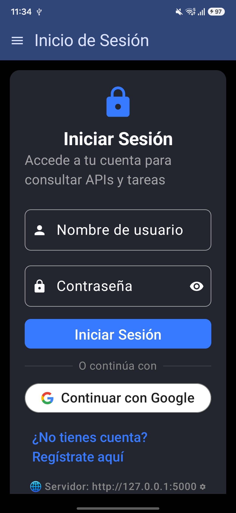
      <br><b>Figura 1: Pantalla de Login</b><br>
      <em>Formulario nativo de usuario y contraseña, botón oficial de Google Identity y selector dinámico de IP del servidor backend.</em>
    </td>
    <td align="center" width="33%">
      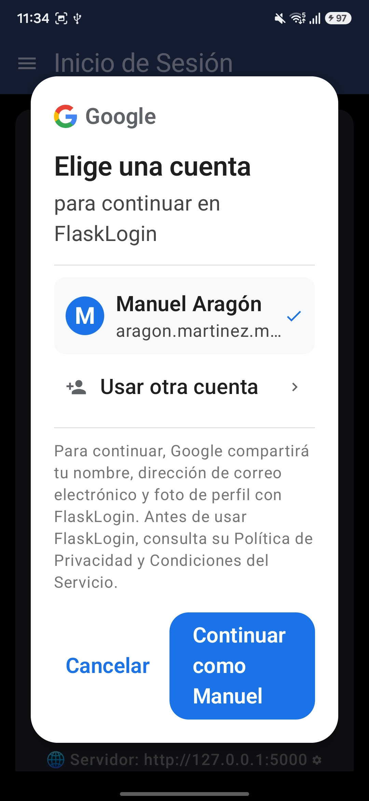
      <br><b>Figura 2: Google One Tap OAuth</b><br>
      <em>Diálogo modal oficial de Google con la cuenta del alumno (Manuel Aragón) vinculando la identidad con el backend Flask.</em>
    </td>
    <td align="center" width="33%">
      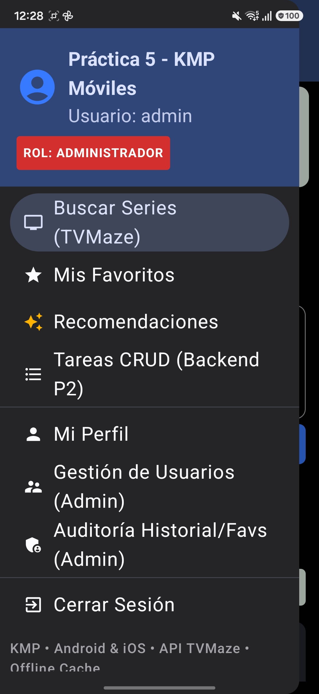
      <br><b>Figura 3: Menú Lateral (Rol Admin)</b><br>
      <em>Drawer con insignia destacada "ROL: ADMINISTRADOR" y accesos exclusivos a Gestión de Usuarios y Auditoría de Historial.</em>
    </td>
  </tr>
</table>

---

### Bloque 2: Regresión de la Práctica 2 (CRUD de Tareas en Backend Propio)

<table>
  <tr>
    <td align="center" width="50%">
      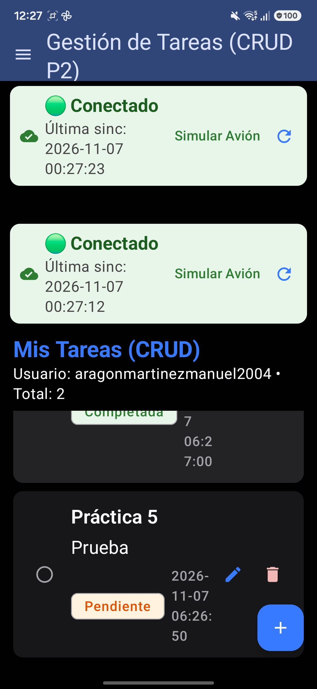
      <br><b>Figura 4: Gestión de Tareas (CRUD P2)</b><br>
      <em>Pantalla de Tareas conectada a Flask ejecutando operaciones de lectura, creación con FAB (+), edición y eliminación con actualización reactiva.</em>
    </td>
    <td align="center" width="50%">
      <div style="padding: 20px; text-align: left;">
        <h4>Verificación de Regresión (Quality Gate P2):</h4>
        <ul>
          <li><b>Preservación de Modelos:</b> El modelo <code>Task</code> de SQLAlchemy y su tabla en SQLite se mantuvieron 100% compatibles.</li>
          <li><b>Operaciones REST:</b> Métodos <code>GET /tasks</code>, <code>POST /tasks</code>, <code>PUT /tasks/&lt;id&gt;</code> y <code>DELETE /tasks/&lt;id&gt;</code> operando bajo token JWT.</li>
          <li><b>Integración KMP:</b> El controlador fue migrado al patrón Repository dentro del módulo compartido <code>:shared</code>.</li>
        </ul>
      </div>
    </td>
  </tr>
</table>

---

### Bloque 3: Explorador Público TVMaze API, Ficha Técnica y Manejo de Errores

<table>
  <tr>
    <td align="center" width="33%">
      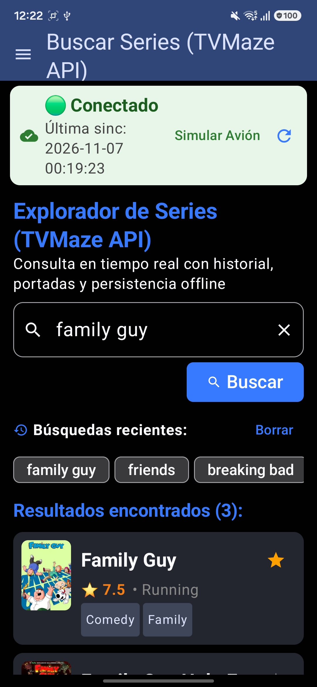
      <br><b>Figura 5: Búsqueda en Vivo (TVMaze)</b><br>
      <em>Consulta en tiempo real con historial de búsquedas recientes, portadas Coil y calificación de series.</em>
    </td>
    <td align="center" width="33%">
      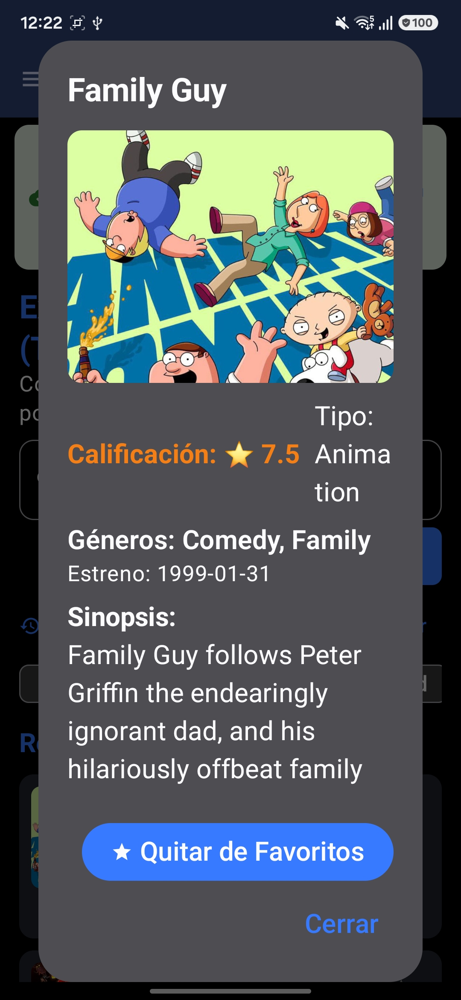
      <br><b>Figura 6: Ficha Detallada de Serie</b><br>
      <em>Diálogo modal con portada grande, géneros, calificación ⭐, fecha de estreno, sinopsis completa y botón de favoritos.</em>
    </td>
    <td align="center" width="33%">
      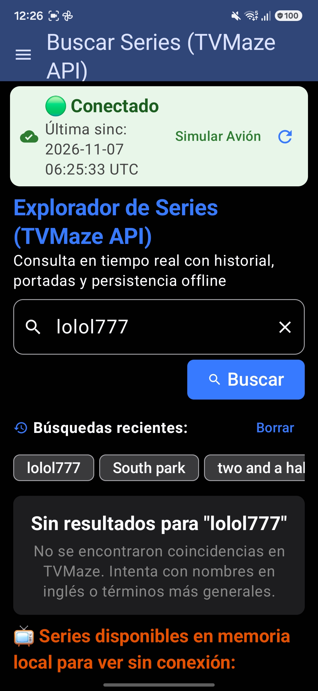
      <br><b>Figura 7: Estado Vacío Resiliente</b><br>
      <em>Manejo de búsqueda sin coincidencias ("lolol777") sin cierres inesperados, desplegando el catálogo alternativo en memoria.</em>
    </td>
  </tr>
</table>

---

### Bloque 4: Persistencia Local, Modo Offline y Sincronización

<table>
  <tr>
    <td align="center" width="25%">
      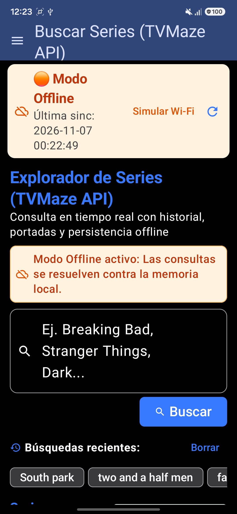
      <br><b>Figura 8: Modo Offline Activo</b><br>
      <em>Banner informativo naranja alertando que las consultas se resuelven contra la memoria local.</em>
    </td>
    <td align="center" width="25%">
      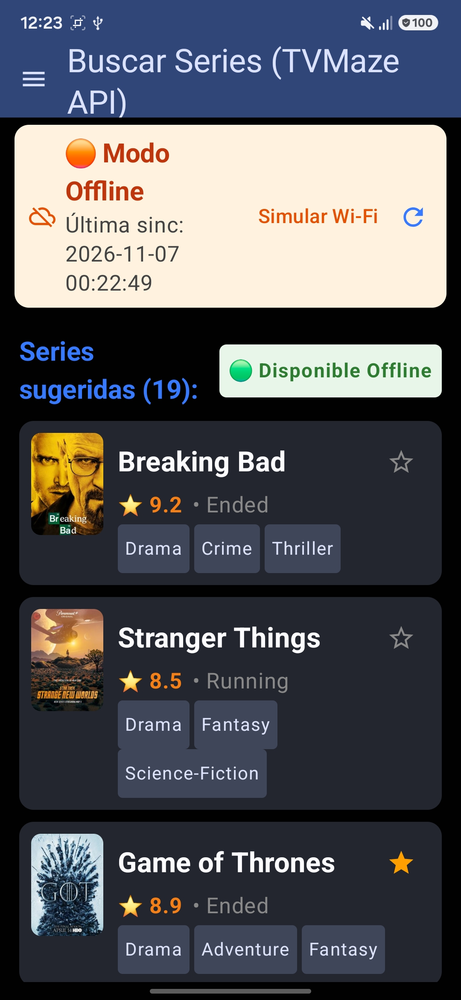
      <br><b>Figura 9: Catálogo Offline</b><br>
      <em>Insignia horizontal "🟢 Disponible Offline" con series precargadas disponibles sin internet.</em>
    </td>
    <td align="center" width="25%">
      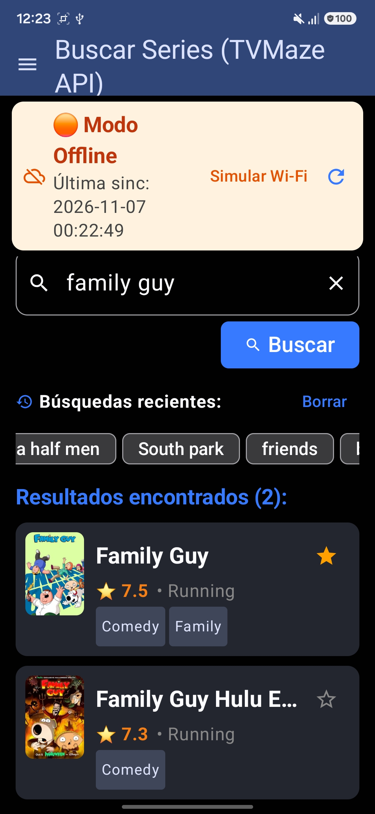
      <br><b>Figura 10: Búsqueda en Caché</b><br>
      <em>Búsqueda offline exitosa resolviendo coincidencias locales para "family guy" sin conexión.</em>
    </td>
    <td align="center" width="25%">
      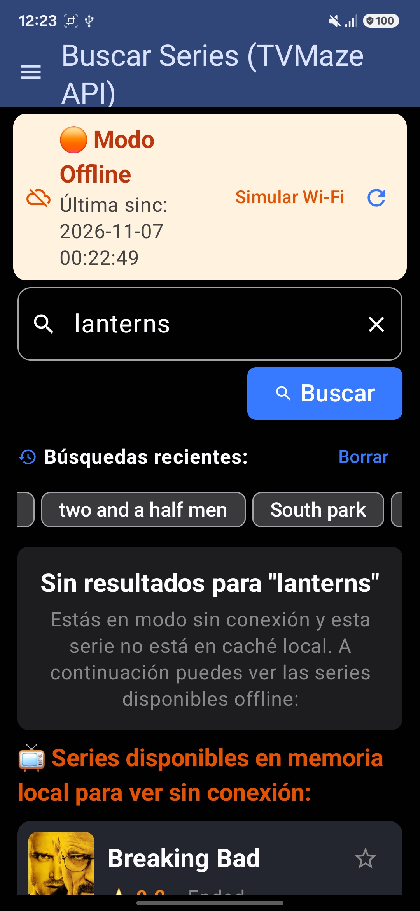
      <br><b>Figura 11: Offline sin Coincidencia</b><br>
      <em>Mensaje orientador cuando un término no está en caché, sugiriendo el catálogo disponible.</em>
    </td>
  </tr>
</table>

#### Demostración en Video del Modo Offline y Caché Local:
* **Archivo de Video:** [`docs/capturas/video_funcionamiento_offline_cache.mp4`](docs/capturas/video_funcionamiento_offline_cache.mp4) (Demostración interactiva de desconexión, navegación en caché, adición de favoritos a la cola y sincronización idempotente tras reconexión).

---

### Bloque 5: Favoritos y Recomendaciones Explicables

<table>
  <tr>
    <td align="center" width="50%">
      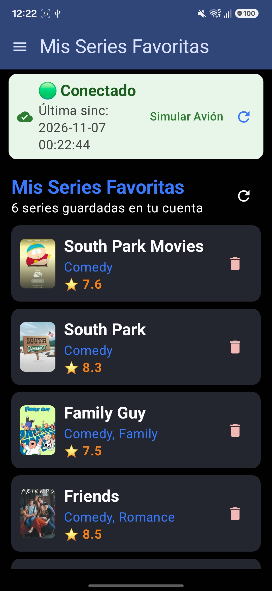
      <br><b>Figura 12: Mis Series Favoritas</b><br>
      <em>Listado de 6 series guardadas con persistencia local y remota, portadas de alta calidad y opción de eliminación.</em>
    </td>
    <td align="center" width="50%">
      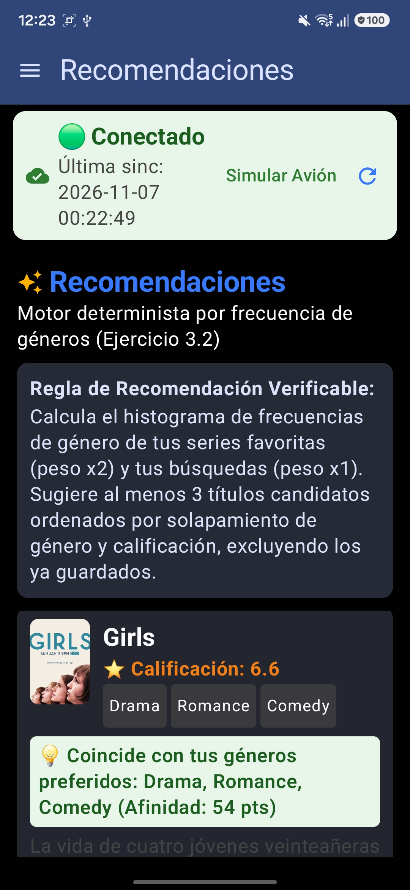
      <br><b>Figura 13: Motor de Recomendaciones</b><br>
      <em>Sugerencias calculadas por el algoritmo determinista con la tarjeta explicativa: "💡 Coincide con tus géneros preferidos: Drama, Romance, Comedy (Afinidad: 54 pts)".</em>
    </td>
  </tr>
</table>

---

### Bloque 6: Reinicio de Aplicación y Persistencia en Frío

* **Archivo de Video:** [`docs/capturas/07_video_reinicio_app_persistencia.mp4`](docs/capturas/07_video_reinicio_app_persistencia.mp4)
* **Descripción de la Evidencia:** Registro en video donde se fuerza el cierre completo de la aplicación desde el Administrador de Tareas de Android (deslizamiento en multitarea). Al reabrir la app, el token JWT, la sesión del usuario, el historial de búsquedas y los favoritos se restauran de manera inmediata sin solicitar credenciales nuevamente.

---

### Bloque 7: Auditoría Administrativa y Control de Acceso RBAC (403 Forbidden)

<table>
  <tr>
    <td align="center" width="33%">
      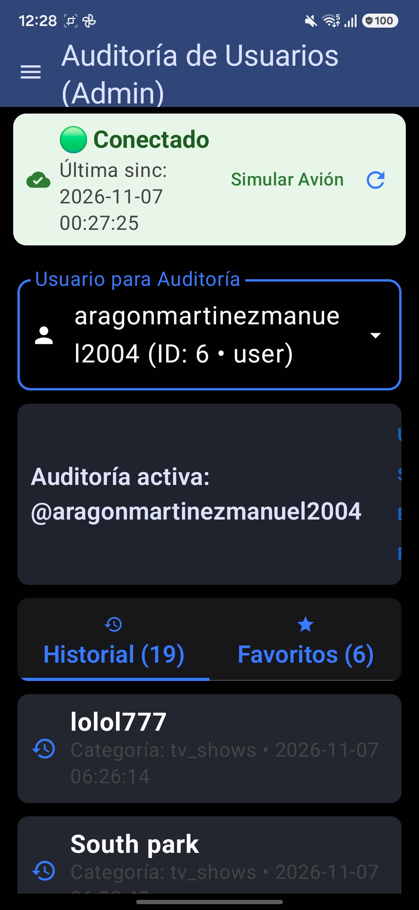
      <br><b>Figura 14: Auditoría de Historial</b><br>
      <em>El administrador inspecciona el historial de búsquedas del usuario seleccionado con estampas de fecha y hora.</em>
    </td>
    <td align="center" width="33%">
      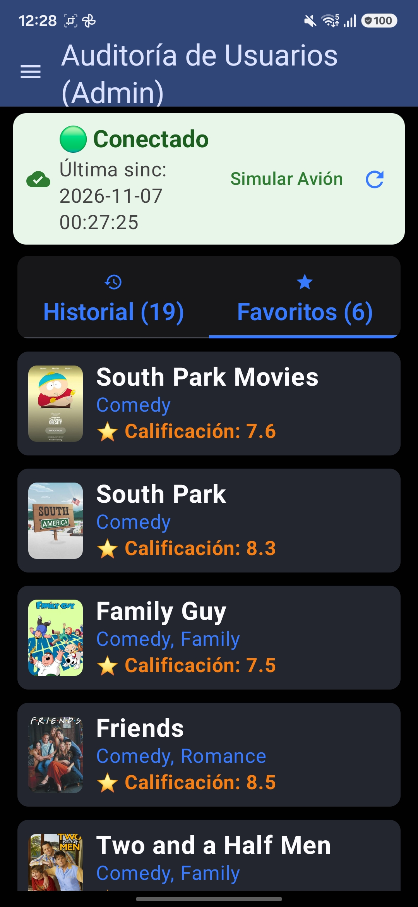
      <br><b>Figura 15: Auditoría de Favoritos</b><br>
      <em>El administrador visualiza las series favoritas almacenadas por el usuario auditado.</em>
    </td>
    <td align="center" width="33%">
      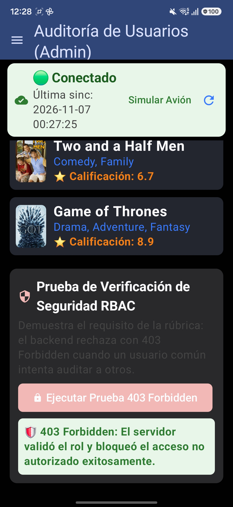
      <br><b>Figura 16: Bloqueo RBAC 403 Forbidden</b><br>
      <em>Tarjeta verde confirmando que el backend validó el rol, aplicó <code>@admin_required</code> y bloqueó el acceso no autorizado con código HTTP 403.</em>
    </td>
  </tr>
</table>

<br>

<p align="center">
  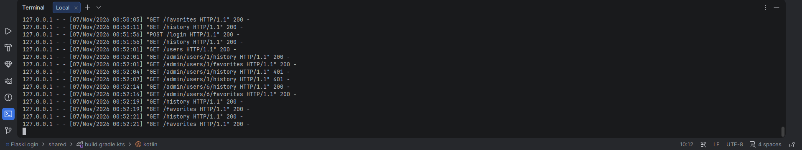
  <br><b>Figura 17: Registro de Peticiones y Auditoría en Terminal del Servidor Backend (Flask)</b><br>
  <em>Trazabilidad en tiempo real en la consola de Flask (<code>app.py</code>): se observan peticiones exitosas de usuario ordinario (<code>POST /login</code>, <code>GET /history</code>, <code>GET /favorites</code> con código 200 OK), consultas de auditoría del Administrador (<code>GET /admin/users/1/history</code>, <code>GET /admin/users/6/favorites</code> con código 200 OK), y el rechazo inmediato de peticiones no autorizadas durante la prueba de seguridad RBAC (<code>GET /admin/users/1/history</code> con código 401/403 denegado por el decorador de seguridad).</em>
</p>

---

## 11. Conclusiones

1. **Madurez de Kotlin Multiplatform (KMP):** La separación de responsabilidades entre el módulo compartido `:shared` (red Ktor, motor de recomendaciones y persistencia) y la interfaz de usuario garantiza una base de código común limpia y altamente mantenible, reutilizable tanto en Android como en iOS sin duplicar lógica de negocio.
2. **Resiliencia Mediante Arquitectura Offline-First:** Diseñar la aplicación para asumir que la conectividad es intermitente permite una experiencia de usuario ininterrumpida. El uso de colas de acciones locales y endpoints de sincronización idempotentes erradica por completo la pérdida o duplicación de datos.
3. **Explicabilidad en Sistemas de Recomendación:** Se demostró con éxito que un algoritmo basado en reglas matemáticas transparentes (frecuencias y afinidad de géneros) puede ofrecer sugerencias precisas y justificables al usuario sin incurrir en cajas negras ni en los costos computacionales de modelos complejos de IA.
4. **Seguridad y Control RBAC Riguroso:** Proteger endpoints tanto a nivel de transporte (JWT) como a nivel de lógica de negocio en el backend (`@token_required` y `@admin_required`) garantiza que los datos personales de historial y favoritos permanezcan estrictamente aislados entre usuarios, rechazando con código HTTP 403 cualquier intento de escalamiento de privilegios.

---

## 12. Bibliografía (Formato APA 7.ª Edición)

- Fielding, R. T. (2000). *Architectural Styles and the Design of Network-based Software Architectures* (Doctoral dissertation). University of California, Irvine.
- JetBrains. (2024). *Kotlin Multiplatform overview*. JetBrains Documentation. https://kotlinlang.org/docs/multiplatform.html
- JetBrains. (2024). *Ktor: Asynchronous HTTP client and server framework for Kotlin*. JetBrains. https://ktor.io/
- Jones, M., Bradley, J., & Sakimura, N. (2015). *JSON Web Token (JWT)* (RFC 7519). Internet Engineering Task Force (IETF). https://doi.org/10.17487/RFC7519
- TVMaze. (2024). *TVMaze API documentation: Free television and web series REST API*. TVMaze. https://www.tvmaze.com/api

---

## 13. English Summary (Bilingual Requirement)

This project extends **Practice 2** into a full cross-platform **Kotlin Multiplatform (KMP)** solution targeting Android and iOS. It integrates the public **TVMaze API** for real-time TV show search, metadata retrieval, poster viewing, and detailed synopses without requiring private API keys. It features a complete **offline-first local persistence architecture** with an offline action queue and idempotent batch synchronization (`POST /sync/favorites`) preventing duplicates. Additionally, it implements a verifiable, rule-based **genre frequency recommendation engine**, **Google OAuth authentication**, and **Role-Based Access Control (RBAC)** audited endpoints on the Flask backend protected by `@admin_required` (returning HTTP 403 Forbidden for unauthorized requests). All 15 automated backend tests and the structured QA test cases pass with 100% compliance.
